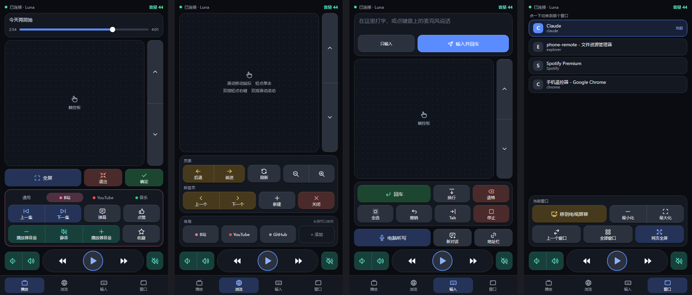

# 手機遙控器

[English](README.md) | [简体中文](README.zh-CN.md) | **繁體中文**

在電腦上執行一個小程式，用手機開啟一個網頁，就能遙控電腦上正在播放的內容：音量、播放與暫停、快轉倒轉、觸控板、捲動、文字輸入，以及 Bilibili、YouTube、瀏覽器和 AI 聊天應用程式的常用快速鍵。

支援 Windows 和 macOS，以 Python 撰寫。手機和電腦需要連上同一個 Wi-Fi。手機上不必安裝任何東西：iPhone、iPad、Android 手機或平板都可以，用內建的瀏覽器開啟即可。

## 執行

最省事的方式是[發行頁面](https://github.com/chrisye96/phone-remote/releases/latest)上打包好的程式，不需要 Python：Windows 用 `PhoneRemote.exe`，Apple 晶片的 Mac（M1 或更新的機種）用 `PhoneRemote-macOS-AppleSilicon.zip`，Intel 處理器的 Mac 用 `PhoneRemote-macOS-Intel.zip`。Mac 第一次啟動的步驟列在發行頁面上。如果想從原始碼執行：

Windows：按兩下 `start-windows.bat`。第一次執行會在儲存庫中建立 `.venv` 虛擬環境並安裝相依套件，需要連上網際網路，大約要一分鐘。

macOS（安裝一次就好，之後只需要最後一行）：

```bash
python3 -m venv .venv
```

```bash
.venv/bin/python -m pip install -e .
```

```bash
.venv/bin/python -m phone_remote
```

第一次在 Mac 上執行時，要在「系統設定 > 隱私權與安全性 > 輔助使用」中允許「終端機」（使用打包好的應用程式時，允許的是「PhoneRemote」）。尚未允許時，QR 碼頁面頂端會顯示操作步驟。

程式沒有視窗，而是在工作列右下角的系統匣中執行（Mac 上是選單列），並開啟一個顯示 QR 碼的頁面。用手機相機掃描即可。想下次像 App 一樣開啟遙控器，可以把頁面加到主畫面：在 Safari 中選「分享 > 加入主畫面」，在 Android 的 Chrome 中選「選單 > 加到主畫面」。

在系統匣圖示上按右鍵，可以再次顯示 QR 碼、開啟或關閉登入時自動啟動（預設為關閉）、重新配對、切換語言或結束程式。「關於」項目會顯示目前執行的版本，並開啟本專案的頁面；版本號也顯示在 QR 碼頁面底部，以及手機上的設定中（右上角的齒輪）。如果出了問題，請查看記錄檔 `%APPDATA%\PhoneRemote\phone-remote.log`。

若想改在終端機視窗中執行，以便看到程式的輸出：`.venv\Scripts\python -m phone_remote --console`。

### 語言

介面提供英文和中文。第一次使用時，兩端各自採用所在裝置的語言（系統設為中文就顯示中文，其他情況一律顯示英文）；之後以你的選擇為準。共有兩處各自獨立的設定：

- **手機上的遙控器**：點右上角的齒輪，在「語言」下選擇。每支手機各自記住自己的選擇。
- **電腦上的系統匣選單和 QR 碼頁面**：系統匣選單中的 Language（語言）。在終端機模式下，把設定檔中的 `language` 設為 `zh`。

### 更新

程式每天會向 GitHub 查詢一次最新發行版的版本號。有較新的版本時，系統匣選單會多出一個「有新版本」項目，點選後會開啟[發行頁面](https://github.com/chrisye96/phone-remote/releases/latest)；在那裡下載新的檔案（`PhoneRemote.exe`，或對應你那台 Mac 的 zip），取代舊的檔案。如果新檔案換了名稱或放在別的資料夾，它的系統匣選單中「開機自動啟動」會顯示為關閉，因為原本的項目啟動的仍是舊檔案：點一下，它就會改為指向新檔案。程式不會自動下載或安裝任何東西。如果你是從原始碼執行，改用 `git pull` 即可。

這個請求是程式唯一一次主動連上網際網路。若要關閉，把設定檔中的 `check_updates` 設為 `false`。

手機上的遙控器頁面不需要更新：它由電腦提供，所以永遠和電腦上的版本一致。

## 打包成免安裝的獨立程式

Windows：按兩下 `scripts\build-windows.bat`，會在 `dist\` 中產生 `PhoneRemote.exe`（約 20 MB）。把它複製到另一台 Windows 電腦上按兩下即可執行，那台電腦不需要 Python。

macOS：執行 `sh scripts/build-macos.sh`，會在 `dist/` 中產生 `PhoneRemote.app` 和它的 zip 壓縮檔。這個應用程式只能在與建置它的電腦同類的 Mac 上執行（Apple 晶片或 Intel），而且沒有用 Apple 開發者帳號簽署，所以在別台 Mac 上第一次開啟時會要求確認。

正式發行版也由 GitHub Actions 以同樣的方式建置：推送 `v0.5.0` 這類標籤，就會執行測試、建置 exe 和兩個 Mac 應用程式，並發布到發行頁面（`.github/workflows/release.yml`）。Pull Request 則會執行測試並試建置一次。

## 遙控器的四個頁面



（截圖為舊版畫面，按鍵上的文字是中文。）

- **播放**：正在播放的內容（音樂或影片圖示、標題和演出者，以及正在播放的應用程式）、可拖曳的進度列、觸控板、「全屏」/「退出」/「確定」，以及通用、Bilibili、YouTube、音樂四組按鍵。
- **瀏覽**：觸控板、瀏覽器的上一頁和下一頁、重新整理、縮放、分頁切換，以及常用網站的捷徑。
- **輸入**：在手機上打字或聽寫，再把文字送到電腦上目前取得焦點的輸入欄位。點一下文字框，它會放大到填滿螢幕，方便輸入長文；換行會保留（以 Shift+Enter 輸入，因為在多數聊天框中，單按 Enter 會把寫到一半的訊息送出），最多 10,000 個字元。文字框填滿螢幕時，傳送按鈕旁的倒退鍵刪除的是電腦上的字，已經送出的錯字不用收起鍵盤就能修正。下方是編輯鍵（Enter、換行、退格、全選、復原、Tab、網址列），以及直接以按鍵本身命名的控制鍵，因為同一個鍵在不同程式中的作用各不相同：上、下、Shift+Tab、Esc、Ctrl+C。「AI 新對話」會送出 Ctrl/Cmd+Shift+O，在 ChatGPT 中會開始一段新對話。
- **視窗**：列出電腦上開啟的視窗，點一下就把它切換到最前面。這裡也能最大化和最小化。「移到另一塊屏幕」（僅限 Windows）會把目前的視窗移到下一台顯示器，例如把影片送到當作第二個螢幕接上的電視。在 Mac 上，清單列出的是應用程式。

觸控板的用法和筆電一樣：滑動來移動指標，輕點來按一下，雙指輕點來按右鍵，雙指滑動來捲動（快速一撥會繼續捲動，再慢慢停下）。要拖曳時，把手指按住不動，等邊框變成實線再滑動；手指離開就放開。

每個頁面底部都固定有一條播放列：音量減和加、倒轉、播放或暫停、快轉、靜音。

按鍵的顏色代表用途：藍色是播放和主要操作，青色是音量，綠色是確認，黃色是導覽，紅色是離開、關閉和刪除。播放 / 暫停鍵用的是 logo 的青色，因為它是最常按的鍵。

### 網站捷徑

「瀏覽」頁面上的「常用」列最多可放 4 個捷徑；點一下就會在電腦的瀏覽器中開啟該網站。點「+ 新增」並輸入網址（輸入 `bilibili.com` 就夠了）。名稱留空時會使用網頁本身的標題；圓點的顏色取自網站的主題色或圖示。按住捷徑可以編輯或刪除（用鍵盤時，按選單鍵或 Shift+F10 也一樣）。捷徑儲存在設定檔的 `shortcuts` 底下。

### 平板，以及橫拿手機

頁面會依所在的螢幕重新排列：

- **手機直拿**：四個頁面的分頁排在最上面一列、電腦名稱旁邊（以圖示顯示，目前的頁面另外顯示名稱），音量顯示在進度列的尾端，螢幕底部只放播放列，讓觸控板盡量取得最多的高度。
- **手機橫拿**：導覽沿著左側邊緣排列，按鍵在中間，觸控板在右邊並佔滿整個高度。
- **平板橫拿**：同樣的三欄配置，按鍵更大。空間足以同時顯示通用鍵和某個網站的按鍵，「播放」頁面上也會顯示網站捷徑。
- **平板直拿**：觸控板橫跨上方，按鍵在下方分成兩欄。

如果你比較習慣用左手拇指操控指標，請開啟設定（齒輪），把觸控板移到左邊；只要螢幕夠寬就會套用。

「通用」分頁上的「後退」和「前進」鍵每次跳 15 秒。若要更改，在設定中選擇 5、10、15 或 30 秒。Bilibili、YouTube 和「音樂」分頁上的按鍵不受影響。

### 鍵盤與螢幕閱讀器

所有按鍵、導覽和設定也都能用鍵盤、切換控制裝置或螢幕閱讀器（例如 TalkBack 或 VoiceOver）操作：每個控制項都有可朗讀的名稱，目前選取的頁面和分頁也會讀出來。觸控板和拖曳進度列仍然需要手指；捲動鍵和「後退」、「前進」鍵可以完成同樣的工作。

### 遙控多台電腦

在每台電腦上各執行一份程式。掃描其中一台電腦的 QR 碼開啟遙控器，再點最上方的電腦名稱：

- **添加電腦…**：拍下另一台電腦螢幕上的 QR 碼，或輸入 QR 碼下方顯示的網址，同時可以順便取個名稱。（用相機 App 直接掃那個 QR 碼，只會另外開啟一個獨立的遙控器：瀏覽器會把每台電腦的頁面彼此分開。）
- 點一個名稱就會切換到那台電腦。
- **改名…** 和 **移除** 適用於目前這台電腦。

名稱預設為電腦本身的主機名稱。這份清單保存在手機的瀏覽器中，所以換一支手機就得重新新增這些電腦。每台電腦上的程式都必須是具備這項功能的版本。

## 安全性

- **配對碼永遠不會經過網路**。它只存在於 QR 碼和手機裡。每個指令都附帶一個由配對碼計算出的簽章，以及當下的時間。攔截流量的人無法得知配對碼，重送攔截到的指令也不會有任何作用。
- **猜錯會被鎖定**。同一個位址的簽章錯誤 10 次之後，該位址會被忽略 5 分鐘。
- **重新配對**。在系統匣選單中選擇「重新配對」（終端機模式下用 `--reset-pairing`），就會立刻換成新的配對碼。之前配對過的手機全部失效，必須重新掃描。手機遺失，或有其他人看過 QR 碼時，就這麼做。
- **指令沒有加密**。在同一個網路上攔截流量的人，看得到你按了哪些鍵、輸入了什麼。在家裡或自己的手機熱點上沒有問題；在公司、宿舍或咖啡廳的 Wi-Fi 上，不要在「輸入」頁面輸入密碼。

QR 碼裡記錄的是電腦的 IP 位址，而路由器隨時可能更換它。所以頁面在瀏覽器中開啟時，會檢查手機能否也用名稱連到這台電腦（例如 `http://dianna.local:8765`），可以的話就移到那個網址，並帶上這支手機的設定。之後再把頁面加到主畫面，IP 位址改變時圖示也能繼續使用。在無法使用名稱的網路上，頁面會留在 IP 位址，其他一切不變。這項功能推出之前加入的圖示仍是舊網址，因為網頁無法更改自己的圖示；頁面會提示一次新網址，加入新的圖示之後，就可以刪除舊圖示。如果頁面完全打不開，在系統匣圖示上按右鍵，選擇「顯示 QR 碼」再掃描一次。如果 Windows 把這個網路視為「公用」網路，防火牆可能會擋住手機；出現提示時請允許這個程式，或把網路設為「私人」。

## 功能開關

每項功能都可以單獨關閉。第一次執行會建立一個設定檔（啟動時會顯示它的位置；在 Windows 上是 `%APPDATA%\PhoneRemote\config.json`）。把 `features` 底下的對應項目設為 `false`，再重新啟動。之後電腦會拒絕對應的指令，手機上也不再顯示那個部分。

| 開關 | 功能 |
|---|---|
| `touchpad` | 觸控板：移動指標、按一下、捲動 |
| `text_input` | 文字輸入 |
| `windows` | 視窗清單與切換 |
| `play_state` | 顯示正在播放還是已暫停，以及標題 |
| `progress` | 進度列、拖曳跳轉、「後退」和「前進」鍵 |
| `volume_display` | 顯示音量大小 |
| `sleep_timer` | 定時暫停 |
| `open_sites` | 網站捷徑 |
| `site_keys` | Bilibili 和 YouTube 專用按鍵 |
| `browser_keys` | 瀏覽器按鍵 |

音量、播放與暫停、快轉倒轉和基本按鍵是核心功能，無法關閉。

## 程式碼結構

```
src/phone_remote/
  __main__.py      進入點
  config.py        連接埠、配對碼、功能開關
  server.py        HTTP 伺服器：頁面檔案、驗證簽章
  actions.py       指令驗證與分派
  keys.py          按鍵名稱、組合鍵解析
  timer.py         定時暫停
  pairing.py       QR 碼頁面
  siteinfo.py      讀取網站的名稱和代表色（新增捷徑時使用）
  tray.py          系統匣圖示和選單
  autostart.py     登入時自動啟動
  update.py        向 GitHub 查詢是否有新的發行版
  i18n.py          電腦端的介面語言（手機頁面的在 web/js/i18n.js）
  platforms/       每個系統一套實作，其他程式碼只使用 base.py 裡的介面
    base.py
    windows/       input.py  windows.py  media.py  audio.py
    macos/         input.py  windows.py  media.py
  web/             手機頁面：index.html、css/、js/（每個功能一個模組）、icons.svg、vendor/
tests/             自動化測試，不會碰到真正的鍵盤和滑鼠
scripts/           打包腳本、圖示合成腳本和 logo 腳本
docs/              重構計畫
```

執行測試：按兩下 `run-tests.bat`。

## 分支

- `main`：穩定版本，可以直接使用。
- `dev`：日常開發。新工作從 `dev` 分出 `feature/*` 分支，完成後合併回 `dev`，驗證過後再進入 `main`。

## 贊助

手機遙控器是免費的。如果它對你有幫助，歡迎[贊助這個專案](https://buymeacoffee.com/chrisye)。

## 圖示與內附的程式碼

圖示來自 [Tabler Icons](https://tabler.io/icons)（MIT 授權），只有用到的幾十個打包進 `src/phone_remote/web/icons.svg`，因此執行時不會從網際網路抓取任何東西。若要增減圖示，請參考 `scripts/build-icons.py`。

新增其他電腦時從照片中讀取 QR 碼，使用的是 [jsQR](https://github.com/cozmo/jsQR) 1.4.0（Apache License 2.0），原封不動複製到 `src/phone_remote/web/vendor/` 中，旁邊附有它的授權條款。只有使用那個按鈕時，頁面才會載入它。

logo 繪製於 `src/phone_remote/logo.py`：48 px 以上用較大的版本，16 和 32 px 用只有一道訊號弧線的簡化版。`scripts/build-logo.py` 由它產生所有檔案：`web/` 中的 favicon 和主畫面圖示（iOS 一個；Android 則是 `web/manifest.webmanifest` 列出的四個，其中兩個填滿到角落，讓啟動器裁切成自己的形狀）、`docs/logo.svg`，以及 Windows 圖示 `scripts/phone-remote.ico`。系統匣圖示則在程式啟動時由同一個模組繪製。

> 本文由英文版機器翻譯而來，尚未經過母語人士逐行審閱。如有出入，以 [English](README.md) 版本為準。
